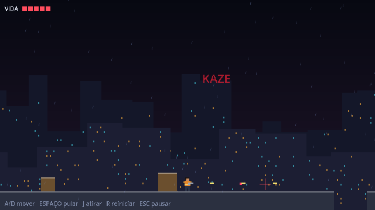
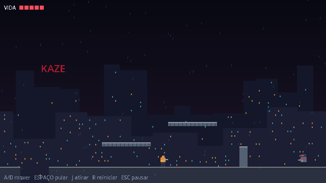
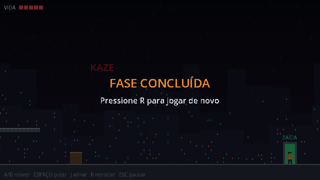

# Último Turno (nome provisório)

Protótipo de **run and gun 2D** inspirado em Metal Slug, feito em Godot 4 + GDScript.
Megacidade latino-americana, noite chuvosa, Kaze Corp. Esta etapa serve só para validar
movimentação, tiro, combate e câmera numa fase curta. Toda a arte é placeholder desenhada
por código (nenhuma imagem no projeto ainda).

| Combate | Percurso | Conclusão |
| --- | --- | --- |
|  |  |  |

## Como rodar

1. Instale o **Godot 4.3 ou mais novo**, versão *Standard*: https://godotengine.org/download
2. Clone o repositório e abra o Godot → **Importar** → selecione `project.godot` → **Importar e editar**.
3. Aperte **F5**. No menu, clique em **Iniciar**.

Linha de comando: `godot --path .` roda o jogo; `godot --path . --editor` abre o editor.

O nome do jogo fica em *Projeto → Configurações do Projeto → Application → Config → Name*
e é usado no menu e na janela.

## Controles

| Ação | Tecla |
| --- | --- |
| Mover | `A` / `D` ou `←` / `→` |
| Pular | `Espaço` (segure para pular mais alto) |
| Atirar | `J` (segure para tiro contínuo) |
| Reiniciar a fase | `R` |
| Pausar | `Esc` |

## O que tem

- **Jogador** (`scenes/player`): anda, pula com coyote time e buffer de pulo, vira para o lado
  em que anda, atira na horizontal com cadência configurável, tem 5 de vida, pisca invulnerável
  por 1 s após levar dano e sofre um pequeno recuo.
- **Projéteis** (`scenes/combat`): cena separada para tiro do jogador e do inimigo
  (camadas de colisão diferentes), com velocidade, dano e tempo de vida. Somem ao bater
  em cenário ou alvo, com uma faísca de impacto.
- **Agente Kaze** (`scenes/enemies`): patrulha entre dois pontos, detecta o jogador dentro do
  alcance e com linha de visão, para, mostra um "!" e acende o cano antes de atirar. Morre com 3 tiros.
- **HUD** (`scenes/ui`): vida, dica de controles e mensagens de pausa, morte e conclusão.
- **Fase de teste** (`scenes/levels/test_level.tscn`): ~2400 px com caixas, passarelas,
  uma barreira, dois buracos, 3 agentes e a saída. Cair mata. Câmera presa aos limites da fase.
  Fundo com duas camadas de parallax e chuva, ambos placeholder.
- Resolução interna 640×360, filtro *nearest* e escala inteira na janela.

Os parâmetros de jogo (velocidade, pulo, vida, cadência, dano, alcance, patrulha) ficam
expostos no Inspetor de cada cena. Plataformas e caixas usam `scenes/levels/platform.gd`:
duplique um nó em `World` e ajuste `size`, `color` e `one_way`.

Para trocar placeholders por sprites, substitua os `Polygon2D` dentro do nó `Visual` do
jogador e do inimigo por um `AnimatedSprite2D`; a lógica não depende do visual.

## Teste automático

```bash
godot --headless --import
godot --headless --script res://tests/smoke_test.gd
```

Verifica movimento, pulo, coyote time, buffer, colisão com parede, tiro nas duas direções,
paredes bloqueando tiros, cadência, dano do inimigo, invulnerabilidade, linha de visão,
morte do inimigo, limites da câmera, pausa, conclusão, reinício, morte por queda e por dano,
e um percurso automático do início até a saída. Roda no GitHub Actions a cada push e PR.
