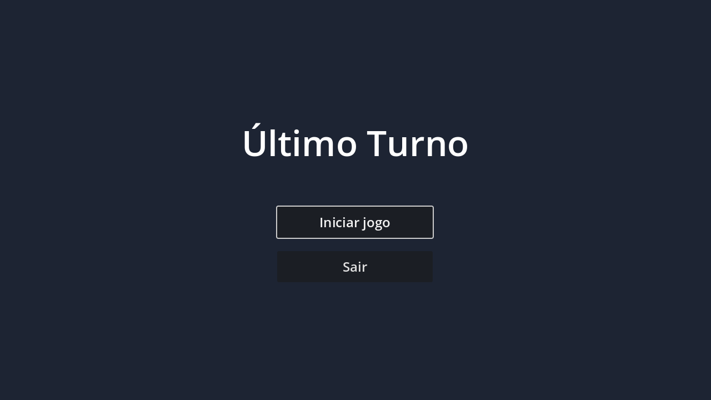
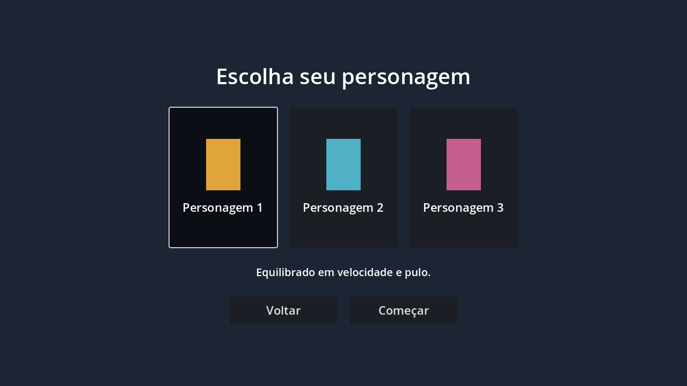
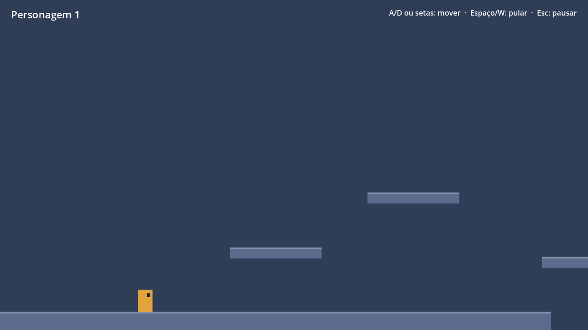

# Último Turno

Jogo 2D de plataforma feito com [Godot 4](https://godotengine.org/) e GDScript.

Versão atual (0.1.0): menu principal, seleção de personagem e uma primeira fase jogável.
Ainda não há história; toda a arte é placeholder (formas coloridas).

| Menu | Seleção de personagem | Fase 1 |
| --- | --- | --- |
|  |  |  |

## Preparando o ambiente

1. Instale o **Godot 4.3 ou mais novo** (versão *Standard*, não precisa da versão .NET):
   - Download: https://godotengine.org/download
   - ou via gerenciador de pacotes: `winget install GodotEngine.GodotEngine` (Windows),
     `brew install --cask godot` (macOS), `flatpak install flathub org.godotengine.Godot` (Linux).
2. Clone o repositório:
   ```bash
   git clone https://github.com/PetersonFonsec/ultimo-turno.git
   ```
3. Abra o Godot, clique em **Importar**, selecione o arquivo `project.godot` na pasta clonada e depois **Importar e editar**.
4. Aperte **F5** (ou o botão ▶) para rodar o jogo.

Pela linha de comando, com o executável do Godot no `PATH`:

```bash
godot --path .            # roda o jogo
godot --path . --editor   # abre o editor
```

> Se você abrir o projeto numa versão mais nova do Godot (4.4+), o editor pode pedir para
> converter o projeto. Pode aceitar; só lembre de atualizar `GODOT_VERSION` no CI.

### Editor de código (opcional)

O editor interno do Godot é suficiente. Se preferir o VS Code, instale a extensão
[godot-tools](https://marketplace.visualstudio.com/items?itemName=geequlim.godot-tools) e, no Godot,
em *Editor > Configurações do Editor > Texto > Editor Externo*, aponte para o VS Code.

## Controles

| Ação | Teclas |
| --- | --- |
| Mover | `A` / `D` ou `←` / `→` |
| Pular | `Espaço`, `W` ou `↑` (segure para pular mais alto) |
| Pausar | `Esc` |
| Navegar nos menus | Mouse ou setas + `Enter` |

## Estrutura do projeto

```
project.godot                 Configuração do projeto (cena inicial, autoloads, controles)
scripts/autoload/game_state.gd Estado global: lista de personagens e personagem escolhido
scenes/
  menus/main_menu.*           Menu principal
  menus/character_select.*    Seleção de personagem
  player/player.*             Personagem jogável (CharacterBody2D)
  levels/level_01.*           Primeira fase (HUD, pausa, bandeira de chegada)
  levels/platform.gd          Plataforma retangular configurável pelo Inspetor
assets/                       Sprites, áudio e fontes (vazio por enquanto)
tests/smoke_test.gd           Teste automático do fluxo menu -> seleção -> fase
```

## Como estender

- **Novo personagem:** adicione uma entrada em `CHARACTERS` em `scripts/autoload/game_state.gd`
  (nome, descrição, cor, `speed`, `jump_velocity`). A tela de seleção cria o card sozinha.
- **Arte de verdade:** troque o `Polygon2D` `Body` em `scenes/player/player.tscn` por um
  `Sprite2D`/`AnimatedSprite2D` com imagens em `assets/sprites/`.
- **Plataformas:** na cena da fase, duplique um nó dentro de `Platforms` e ajuste `size`
  e `color` no Inspetor; a colisão acompanha.
- **Nova fase:** duplique `scenes/levels/level_01.tscn` e aponte para ela em `GameState`.

## Testes

```bash
godot --headless --import
godot --headless --script res://tests/smoke_test.gd
```

O teste abre o menu, escolhe um personagem, entra na fase e verifica que o personagem
cai no chão, anda e pula. O mesmo teste roda no GitHub Actions a cada push e pull request.
